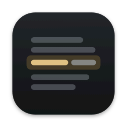
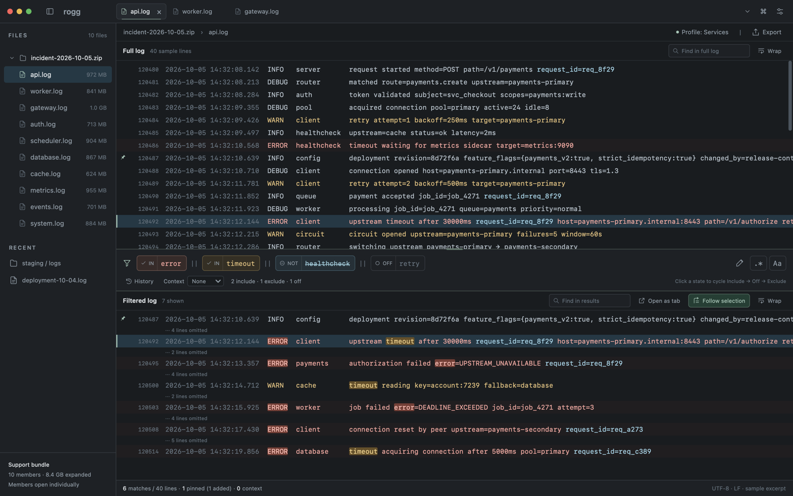
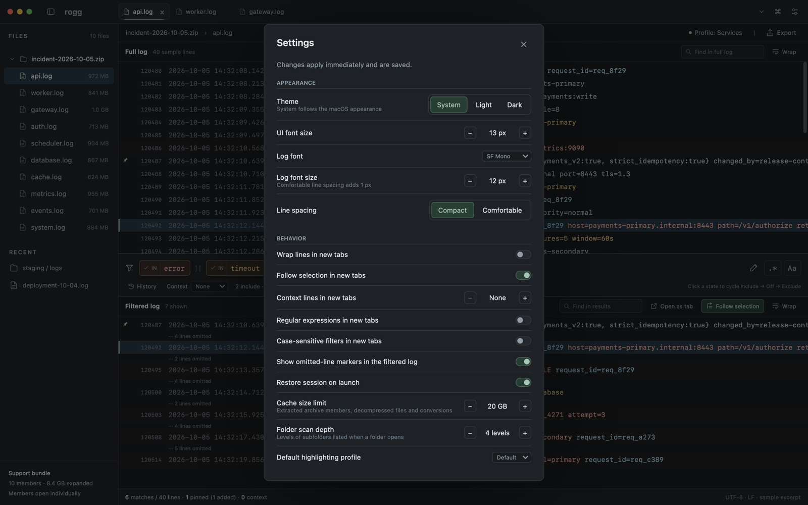

<div align="center">



# rogg

**A fast, native log explorer for macOS, Linux and Windows.**

In the spirit of glogg/klogg: the full log on top, a filter line in the middle, the filtered log at the bottom. Written in Rust with [gpui](https://www.gpui.rs).

[](https://github.com/rogg-log/rogg/actions/workflows/build.yml) [](https://github.com/rogg-log/rogg/releases/latest)  

[Install](#install) · [Features](#features) · [Platforms](#platforms) · [Development](#development)

</div>

<br>

<picture>
  <source media="(prefers-color-scheme: dark)" srcset="docs/images/rogg-dark.png">
  <source media="(prefers-color-scheme: light)" srcset="docs/images/rogg-light.png">
  
</picture>

## Features

- **Big logs, no waiting.** Opens single logs up to about 1 GB. Indexing and filtering run in the background with progress, so the window never freezes and any job can be cancelled.
- **Support bundles.** Opens `.zip`, `.tar`, `.tar.gz`, `.tgz` and `.gz` files, including nested archives. Members are listed in the sidebar and extracted only when you open them.
- **Filter chips.** Write `error || timeout || healthcheck`, then click each term to cycle it between *include*, *off* and *exclude*. Each term gets its own match colour. Regex and case-sensitive modes are one click away.
- **Context that stays readable.** Pinned lines always show. Context (±N lines) can be added around matches, and skipped stretches collapse into `··· N lines omitted`.
- **Live follow.** Tails growing files and handles truncation and rotation. It also reads stdin: `some-command | rogg -`.
- **Highlighting profiles.** Colour lines and matches with ordered rules, switch profiles per tab, and import or export them.
- **Search, export, sessions.** Each panel has its own search. You can export the filtered lines, open a filtered view as its own tab, and pick up where you left off with session restore.
- **Looks native.** Dark and light themes, compact and comfortable density, and window chrome that follows the platform.

<picture>
  <source media="(prefers-color-scheme: dark)" srcset="docs/images/settings-dark.png">
  <source media="(prefers-color-scheme: light)" srcset="docs/images/settings-light.png">
  
</picture>

## Install

**macOS and Linux**

```bash
curl -fsSL https://raw.githubusercontent.com/rogg-log/rogg/main/install.sh | bash
```

The installer asks what to install (on macOS: `rogg.app` or the command-line binary) and where (`/Applications` for
the app, `~/.local/bin` for the binary). It shows the installed and the new version before changing anything, checks
the download against the release's `SHA256SUMS`, offers to add the binary's folder to your `PATH`, and on Linux offers
an applications-menu entry. Run it again to upgrade. To remove rogg (settings and data are kept):

```bash
curl -fsSL https://raw.githubusercontent.com/rogg-log/rogg/main/install.sh | bash -s -- --uninstall
```

**Windows** (PowerShell), to install or upgrade, and to uninstall:

```powershell
irm https://raw.githubusercontent.com/rogg-log/rogg/main/install.ps1 | iex
& ([scriptblock]::Create((irm https://raw.githubusercontent.com/rogg-log/rogg/main/install.ps1))) -Uninstall
```

It installs to `%LOCALAPPDATA%\Programs\rogg` (no admin rights), offers to add that folder to your PATH and a Start
menu entry, and reads the installed version from `rogg.exe`'s properties.

**Manual download.** Grab an archive for your platform from the [latest release](https://github.com/rogg-log/rogg/releases/latest).
`rogg --version` shows the installed version and build (on Windows: `rogg.exe` → Properties → Details).

> [!NOTE]
> Both installers download without credentials, so they work only once the repository is public.

## Platforms

| | Status | Settings and data | Cache | Keys |
|---|---|---|---|---|
| **macOS** 11+, Apple silicon and Intel | Primary platform, fully verified | `~/Library/Application Support/rogg` | `~/Library/Caches/rogg` | ⌘, native menu bar |
| **Linux** x86_64 and arm64, glibc 2.35+ | Verified in a container, not yet on a real desktop | `~/.config/rogg`, `~/.local/share/rogg` | `~/.cache/rogg` | Ctrl, ☰ menu |
| **Windows** x86_64 | Built in CI, not yet tested by hand | `%APPDATA%\rogg` | `%LOCALAPPDATA%\rogg\cache` | Ctrl, ☰ menu |

On Linux, settings and profiles live in `$XDG_CONFIG_HOME/rogg`; history, recent files and the session in
`$XDG_DATA_HOME/rogg`; the cache in `$XDG_CACHE_HOME/rogg`. Wayland and X11 are both supported. The window draws its
own title bar unless the window manager insists on server-side decorations.

On Linux and Windows, Ctrl replaces ⌘ (Ctrl+O, Ctrl+F, Ctrl+L). The ⌘H, ⌥⌘H and ⌘M shortcuts are macOS-only; Minimise
stays in the ☰ menu and the window controls. Ctrl+Q quits on Linux; on Windows, Alt+F4 closes the window and the ☰ menu
has Quit.

## Development

`./dev` is the single entry point: run `./dev setup` once, then `./dev help` lists every command.
`./dev check` builds, runs clippy, all tests and the golden visual check (it must report 0.000%).

Design: [`docs/superpowers/specs/2026-10-06-rogg-design.md`](docs/superpowers/specs/2026-10-06-rogg-design.md) (the app)
and [`docs/superpowers/specs/2026-10-09-rogg-cross-platform-design.md`](docs/superpowers/specs/2026-10-09-rogg-cross-platform-design.md) (Linux and Windows).

<details>
<summary><b>macOS</b></summary>

- **Build and run:** `./dev setup` once, then `./dev build`, `./dev run [files...]` (`-` reads stdin), `./dev demo`, `./dev gallery`.
- **Check:** `./dev check` builds, runs clippy, all tests and the golden visual check (it must report 0.000%).
- **Data:** settings, profiles, history, recent files and the session live in `~/Library/Application Support/rogg`; the cache is `~/Library/Caches/rogg`.
- **Keys:** the shortcuts use ⌘ (for example ⌘O, ⌘F, ⌘L). The native menu bar is used.

</details>

<details>
<summary><b>Linux</b></summary>

Verified in a container, not yet on a real desktop. Wayland and X11 are both supported by gpui. The window draws its own title bar and ☰ menu; under a window manager that insists on server-side decorations, the system title bar is shown and rogg hides its own window controls.

- **Build and run (on a Linux machine):** `cargo build --release`, then `target/release/rogg [files...]`. The gpui build dependencies are listed in `tools/linux/Containerfile`.
- **From macOS:** `./dev linux-image` builds the `debian:trixie` image (needs Apple `container`). `./dev linux-build` and `./dev linux-test` build and test inside it. `./dev linux-shot [demo|<page>]` screenshots the running app under Xvfb with xfwm4 and lavapipe into `target/linux/shots/`. `./dev linux-shell` opens a shell.
  - `ROGG_LINUX_CPUS` (default 6) and `ROGG_LINUX_MEMORY` (default 20G) set the container limits.
- **Data:** settings and profiles in `$XDG_CONFIG_HOME/rogg` (else `~/.config/rogg`); history, recent files and the session in `$XDG_DATA_HOME/rogg` (else `~/.local/share/rogg`); the cache in `$XDG_CACHE_HOME/rogg` (else `~/.cache/rogg`).
- **Keys:** Ctrl replaces ⌘ (Ctrl+O, Ctrl+F, Ctrl+L), and Ctrl+Q quits. The ⌘H (Hide), ⌥⌘H (Hide Others) and ⌘M (Minimise) shortcuts are macOS-only; Minimise itself stays in the ☰ menu and the window controls.
- **Verified:** the workspace builds and its tests pass in the container, and `linux-shot` checks that the window renders. Hand checks on a real desktop are listed in `docs/superpowers/notes/2026-10-09-cross-platform-manual-checks.md`.

</details>

<details>
<summary><b>Windows</b></summary>

Cross-built from macOS for development; release builds are made natively in CI. It has not been run by hand yet.

- **Build:** `./dev windows-build` runs `cargo xwin build --workspace --target x86_64-pc-windows-msvc`. It needs the rustup target `x86_64-pc-windows-msvc`, `cargo-xwin` and Homebrew `llvm`; `./dev setup` offers all three after asking.
- **Run:** copy `target/x86_64-pc-windows-msvc/debug/rogg.exe` to a Windows machine. `rogg.exe -` reads stdin. That debug build keeps a console window for its output; a release build opens none, but it has to be made on Windows (`cargo build --release`), because gpui compiles its release shaders with the Windows SDK's `fxc.exe`.
- **Data:** settings, profiles, history, recent files and the session in `%APPDATA%\rogg`; the cache in `%LOCALAPPDATA%\rogg\cache`.
- **Keys:** Ctrl replaces ⌘. Alt+F4 closes the window, and the ☰ menu has Quit. The ⌘H, ⌥⌘H and ⌘M shortcuts are macOS-only; Minimise stays in the ☰ menu and the window controls.
- **Verified:** it compiles and links, and the Windows code paths are compile-checked. The tests are compile-checked only. The manual checks note covers the first run and the known Windows-only risks around memory-mapped logs.

</details>

<details>
<summary><b>Other notes</b></summary>

- `ROGG_CHROME=mac|linux|windows` overrides the window chrome style at startup, and the gallery takes `--chrome`. On macOS, `./dev capture <page> <appearance> <density> [chrome]` captures the other styles.
- `./dev check-all` runs `check`, `linux-test` and `windows-build`.
- The README screenshots are headless captures of the real app in demo mode: `target/release/rogg-gallery --capture app [--dialog appearance] --theme dark|light --out <png>`, scaled to 1600 px wide.

</details>

<details>
<summary><b>Builds and releases</b></summary>

Every push to `main` runs [`.github/workflows/build.yml`](.github/workflows/build.yml). It runs clippy and the
tests on Linux, then builds:

| File | Platform |
|---|---|
| `rogg-macos-universal.tar.gz` | macOS 11+, Apple silicon and Intel: the bare `rogg` binary (ad-hoc signed, not notarised) |
| `rogg-macos-universal-app.tar.gz` | the same binary as `rogg.app`, to open from Finder (ad-hoc signed, not notarised) |
| `rogg-linux-x86_64.tar.gz` | Linux x86_64, glibc 2.35+ |
| `rogg-linux-arm64.tar.gz` | Linux arm64, glibc 2.35+ |
| `rogg-windows-x86_64.zip` | Windows x86_64 |

Each build becomes its own release, `v<version>-build.<n>` (titled e.g. `rogg 0.1.0 · build 5 · 2026-10-10 ·
5497615`), with `SHA256SUMS` and `manifest.json` (version, build number, commit, and each file's checksum and `kind`,
`binary` or `app`). The release is published only once every file is attached, and is marked latest; the newest 30
builds are kept. Latest files: `https://github.com/rogg-log/rogg/releases/latest/download/<file>`; a given build:
`…/releases/download/v0.1.0-build.5/<file>`. Check every download against `SHA256SUMS`. While the repository is
private, downloads need a GitHub token (`gh release download`).

`./dev ci-test` tests the packaging scripts locally; `./dev ci-lint` lints the workflow; `./dev mac-app` builds
`rogg.app` for this Mac into `target/mac-app/`; `./dev icon` regenerates the app icon from `crates/rogg-app/assets/icon/rogg.svg`.

</details>
